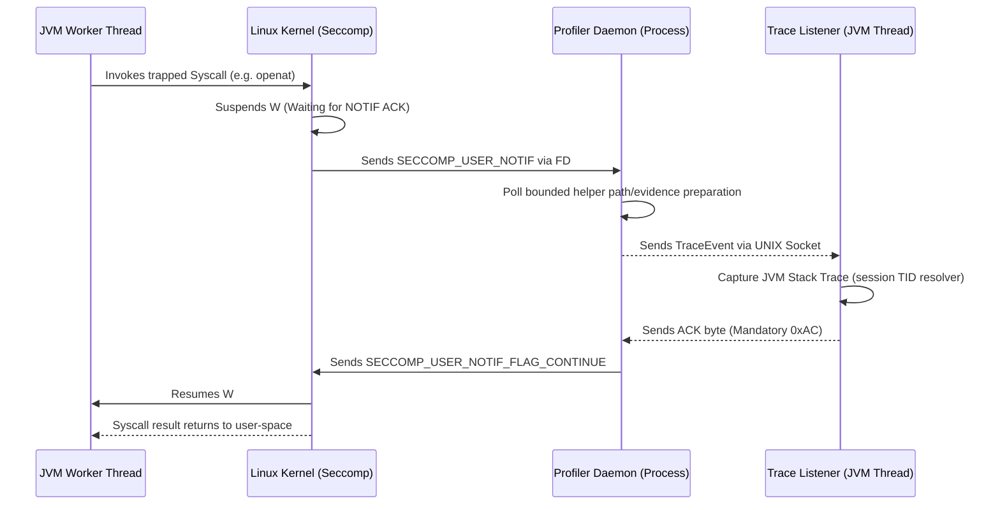
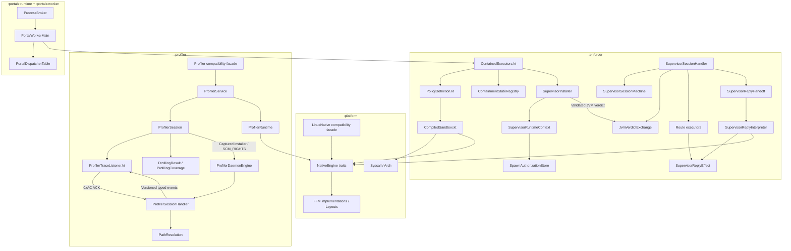

# Architectural Knowledge Graph & System Mapping

This document provides a high-level "Knowledge Graph" of the `mazewall` system. It is designed to help AI agents and developers understand the distributed nature of the profiler, the immutable boundaries of the enforcer, and the critical IPC loops that connect them.

The completed post-review hardening work has a compact [finding-to-test-to-commit evidence index](post-review-hardening-evidence.md) for reviewers.
The active follow-up is tracked in the [PMR evidence table](post-review-hardening-evidence.md#post-merge-remediation-evidence-pmr)
and the [post-merge verification ledger](review-hardening-verification.md#post-merge-remediation-run-ledger).
The [notification liveness contract](notification-liveness-contract.md) is the cross-module
entry point for deadlines, admission, helper cancellation, listener health and ownership.

## 1. System Component Overview

| Component | Responsibility | Process/Thread | Lifecycle |
|-----------|----------------|----------------|-----------|
| **Enforcer Engine** | BPF compilation and filter installation. | Target JVM (Worker Thread) | Final / Immutable once applied. |
| **Containment Registry** | Tracks process-wide and thread-scoped seccomp/Landlock state. | Target JVM | Mirrors irreversible kernel installation. |
| **Supervisor Runtime Context** | Owns TID lookup and consume-once spawn authorization keyed by PID + process start time. | Target JVM validation listener | Installation/session-owned; never a sidecar authorization cache. |
| **Supervisor Session Handler** | Coordinates the notification reducer, JVM exchange, route executors, setup ownership handoff and sole reply interpreter. | Supervisor sidecar process | One connection; terminal reply failure ends the session. |
| **Profiler Service / Session** | Captures runtime dependencies; sessions own listeners, TID mappings, evidence buffers and cleanup outcomes. | Target JVM | Internal owners behind the public `Profiler` facade. |
| **Profiler Daemon** | Out-of-process `USER_NOTIF` handling & memory reading. | Child Process (Java/JVM) | Per-connection sessions; remains available for permanent filters in pass-through mode. |
| **Trace Listener** | Captures stack/evidence through its session's injected TID resolver. | Target JVM (Dedicated Thread) | Bound to one profiler session. |
| **BobCompiler** | Generates `BillOfBehavior` JSON from trace events. | Target JVM (Tooling) | Static/Post-process. |
| **Process portal** | Pooled worker JVMs + RPC/`SCM_RIGHTS` for first-party modules. | Broker JVM + worker processes | Implemented (`:portals:runtime`, `:portals:worker`). Workers use a curated classpath; guest types are not on the broker runtime. Distinct from the syscall supervisor. |
| **Portal Dispatcher Table** | Immutable method-to-handler authority, strictly validated at worker startup. | Worker JVM | Built once before serving requests; no mutation through the legacy registry after publication. |

## 2. The Profiler-Enforcer ACK Loop (The "Deadlock Zone")

The target JVM thread remains blocked until a kernel reply resolves its notification.
The reactor enforces one absolute 30-second deadline across preparation, publication and
ACK. Expiry claims the sole terminal reply lease, attempts EPERM once and closes the session.
The loop below is the successful observation path; it does not renew that deadline.

### ⚠️ Agent Safety Rules for the ACK Loop:
- **No Blocking in Daemon:** The Daemon must never block on a resource that requires the JVM Worker Thread to be active (e.g., a JVM-held lock).
- **Deadline ownership:** Only the reactor claims and executes a terminal reply. Helper completion can transfer evidence/resources or dispose late results; it cannot send a reply. `NotificationGone` is terminal, never successful delivery.
- **Socket Interruption:** The Trace Listener must handle `EINTR` on its socket reads to prevent missing an event.
- **FD Management:** The daemon owns its received listener FD. Cleanup outcomes must remain visible to the session owner; closing a local duplicate does not close another process's descriptor. Profiler shutdown first moves permanent filters into pass-through mode.
- **Rejected Frames:** After a complete TID header, a rejected profiler event body still receives one ACK before listener termination. It counts as dropped evidence, not as a valid observation.

## 3. Security Boundary Stacking (Tiers)

Mazewall operates in Tiers. An agent must know which Tier a change affects.

- **Tier 1 (Process-Wide):** Applied via `installOnProcess`. Uses `TSYNC`.
    - *Constraint:* Preserve the process-wide JVM-safe baseline and surface synchronization failures; see the [containment design](../enforcer/containment-design.md).
- **Tier 2 (Thread-Scoped):** Applied via `wrap()` or `installOnCurrentThread`.
    - *Boundary:* Other threads do not acquire these restrictions merely by sharing the JVM. Thread-scoped containment is not a complete native ACE boundary; retain Tier 1 or use a separate process.
- **Tier S Profiling:** Uses an out-of-process `USER_NOTIF` daemon on trusted diagnostic workloads.
    - *Boundary:* Tracee-memory inspection needs the appropriate ptrace authorization. The caller installs NEW_LISTENER and optional TSYNC in separate calls; typed inspection failures remain incomplete evidence.

## 4. Cross-Module Dependency Graph

The graph groups Gradle modules, not process address spaces: the supervisor handler and profiler
daemon execute in sidecars, while their JVM listeners retain session-local state. Spawn authorization
is consumed only in the JVM validation listener; the sidecar receives the validated verdict and must
not duplicate or consume a second authorization store. Only the supervisor reply interpreter issues
terminal kernel replies. The profiler's listener ACK is a distinct socket-protocol obligation.
The reply handoff owns descriptor-bearing effects throughout arena/buffer setup, then transfers
them once to the interpreter or disposes them on setup failure. Profiler service/session cleanup
similarly retains unattempted owners after an aborted fold; fatal propagation cannot publish a
stale complete outcome or discard the session's remaining listeners.

For detailed class diagrams and relationship maps of the individual modules:

- See the [Enforcer Architecture Document](../enforcer/enforcer-architecture.md) for the `:enforcer` module.
- See the [Profiler Design Document](../profiler/profiler-design.md) for the `:profiler` module.
- See the [Process Portal Design](../enforcer/process-portal-design.md) for the broker/worker boundary.

`architectural-map.md` is the canonical cross-module knowledge map. The module design documents
above are the canonical locations for their generated PlantUML/SVG class diagrams; do not rely on
historical module maps for independent architecture claims. Those entry points redirect here.
Canonical generated outputs live in `docs/diagrams/`; the unreferenced root `class_diagram.puml`
is a historical artifact, not a generated source of truth.

## 5. Critical Memory Layouts (FFM)

If you modify these, you must update both the Kotlin side and the C-side (if applicable).

- **`sock_filter`:** 8-byte structure used by the BPF compiler.
- **`seccomp_notif`:** Native notification structure, including the aligned `data` field.
- **`msghdr` / `cmsghdr`:** Used for FD passing; fields and alignment must match the native ABI.

Their canonical Kotlin layouts live in `platform`'s `io.mazewall.ffi.Layouts`; platform layout
tests and the compiled C ABI oracle validate those definitions. Task-local runtime refactors must
not change them.

## 6. Failure Modes & Recovery

Cleanup owners in platform, supervisor helpers, and portal use `CleanupFailures.merge` for
fatal-first failure ordering and identity-based suppression. Re-observing the same cleanup
outcome does not append duplicate evidence. The helper performs no resource operations and
does not change the interrupt flag: interruption remains with the owner that knows whether it
must drain before propagation. Protocol violations are distinct from operational I/O failures
and programmer invariant checks. Reducers name idle/await progress and post-terminal
observations explicitly; only active transitions schedule work. The seccomp daemon uses the
shared UNIX listen machine directly, with the public `SeccompDaemonState` alias retained for
source compatibility.

| Symptom | Probable Cause | Investigation Path |
|---------|----------------|--------------------|
| **JVM Hangs on Startup** | Blocked critical syscall (futex, clone). | Check `BpfFilter.jvmCriticalNrs`. |
| **Profiler coverage has missing or partial paths** | Denied memory read, missing operand, unresolved dirfd, or truncated string. | Inspect `ProfilingCoverage.pathFailures` and `SyscallPathResolver`; do not infer completeness from the paths list. |
| **"IllegalStateException: Already restricted"** | Redundant Landlock application on pooled thread. | Check `StateRegistries` usage in `wrap()`. |
| **E2BIG on Landlock install** | Exceeded Landlock domain nesting limit (max 16). | Investigate stacked policy logic in `FilterInstallationPlanner`. |

## 7. Core Architectural Paradigms & Patterns

To maintain security and stability at the kernel-JVM boundary, `mazewall` adheres to a **Functional-Core, Imperative-Shell** architecture using the following patterns:

### A. Type-State Machine Pattern (Safety-by-Construction)
Interfacing with kernel APIs and IPC protocols is sequentially fragile. Type-states restrict
legal construction sequences; exhaustive runtime reducers separately reject protocol violations.
- **Application:** `BpfBuilder<State>` (enforces Arch Check -> Load NR -> Filtering) and `HandshakeSession<State>` (prevents deadlocks by enforcing the 0xAC protocol).

### B. Functional Programming at the Native Boundary
Native calls return `errno` and raw values that are easily lost or misinterpreted.
- **Application:** We use **Monadic Result types** (`SyscallResult<T>`) instead of exceptions for native FFM downcalls. This forces callers to explicitly handle `recover` or `map` logic, preserving the critical `errno` context.

### C. Pragmatic OOP & Strategy Pattern (Platform Abstraction)
The Linux kernel cannot be mocked. We use OOP traits to decouple high-level security logic from low-level FFM implementations.
- **Application:** `NativeEngine` and its sub-traits (`NativeFileSystem`, etc.) allow injecting `MockNativeEngine` for host-side unit testing without a Linux environment.
- **Captured runtime rule:** a long-lived native operation receives one captured
  `NativeEngine`; socket connection, descriptor receipt, UNIX server creation,
  and supervised installation must not re-read mutable global runtime state while
  the operation is in progress. Convenience overloads may capture the default
  runtime once at the composition boundary. `ArchitectureTest` enforces this for
  `SupervisorInstaller`.

### D. Domain-Driven Design (DDD) & Value Objects
To avoid "Primitive Obsession" in a codebase full of pointers and integers, we use DDD principles to define a "Ubiquitous Language" for security.
- **Application:** Ownership/state/role types on `FileDescriptor` and value types such as `Pid` and `SyscallNumber` distinguish native identifiers. Descriptor acquisition receipts, shared lifecycle state and unique active identities additionally prevent raw integers from fabricating close authority.

### E. Architectural Fitness Functions (ArchUnit)
Security is a structural property. We use ArchUnit to ensure that memory-unsafe operations are strictly localized.
- **Application:** Banning direct `java.lang.foreign` or `Unsafe` access outside of the `io.mazewall.ffi` package to prevent structural bypasses of our memory-safety model.
- **Enforcement:** `ArchitectureTest.rawFfmTypesMustResideInFfiPackages` (enforcer) fails the build when any class outside `io.mazewall.ffi..` gains a dependency on `java.lang.foreign`.

### E2. Engine-Aware Native Artifact Caching
Any cache holding engine-produced native artifacts MUST key on `LinuxNative.engineIdentity`
in addition to content: segments produced while a mock engine is active are garbage for the real
engine and cause spurious kernel EINVALs when reused (`BpfNativeCache.NativeCacheKey`;
issue-20260823-180500). Pure-JVM caches (e.g. `PolicyCompilationCache`) are exempt — but their
keys must still be the *program-relevant projection* of inputs, never whole value objects with
irrelevant fields (issue-20260823-171953: FS paths do not affect BPF output).

### F. FFM Package Placement (module split rationale)
Raw FFM code is split across two modules by OWNERSHIP OF ABSTRACTION LEVEL, not arbitrarily:
- **`:platform` `io.mazewall.ffi..`** owns generic, domain-independent ABI surface: `NativeConstants`,
  `LinuxNative` + `RealNativeEngine`, memory primitives (`NativeArena`, `ManagedSegment`,
  layouts), and errno values. Anything reusable without understanding mazewall's policy model
  belongs here.
- **`:enforcer` `io.mazewall.ffi..`** owns domain-shaped FFM structures that depend on enforcer
  concepts: seccomp notification networking (`SupervisorSeccompNotifInstaller`, msghdr/cmsg
  SCM_RIGHTS plumbing), `sock_fprog` wiring, and supervisor process-memory readers.
- **Rule of thumb:** if the code would make sense in any sandboxing library, it belongs to
  `:platform`; if it mentions seccomp/Landlock/supervisor semantics, it belongs to `:enforcer`.
  Both are covered by the ArchUnit FFM-confinement rule above; module direction
  (`:enforcer -> :platform`, never reverse) is enforced by Gradle dependencies.

# Gradle cross-module worker classpaths

Worker JVM classpaths must be represented by a resolvable `Configuration` consumed through an
`@Classpath` `CommandLineArgumentProvider`. Convert it to `asPath` only from `asArguments()`,
which Gradle invokes at task execution time. Keep an explicit dependency on the producer's `jar`
or `classes` task. Do not resolve a configuration from `systemProperty`, a top-level value, or a
configuration-cache provider: those forms either resolve too early or lose producer dependencies.

`scripts/check_gradle_lazy_resolution.sh` guards `.asPath` and `.singleFile` uses in build scripts.
When generating Kotlin build scripts through a shell heredoc, use the correct dollar escaping and
then inspect the result with `grep -F '${' <file>` so interpolations have not been written literally.
