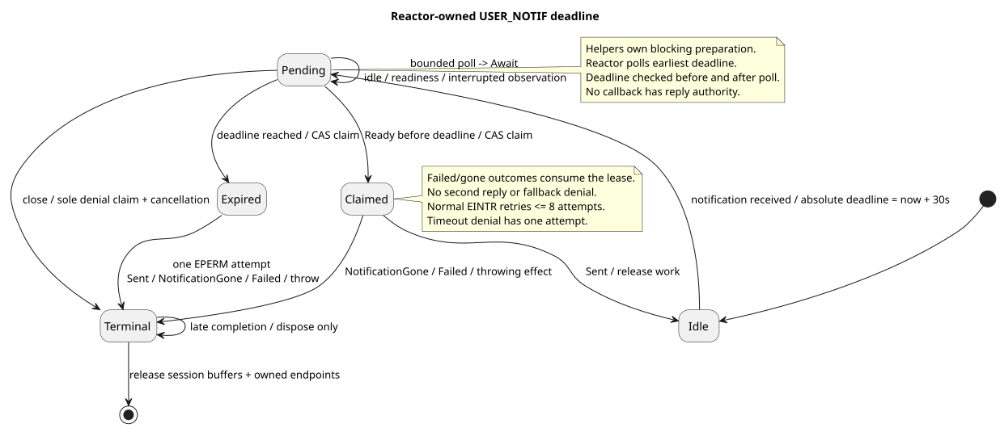
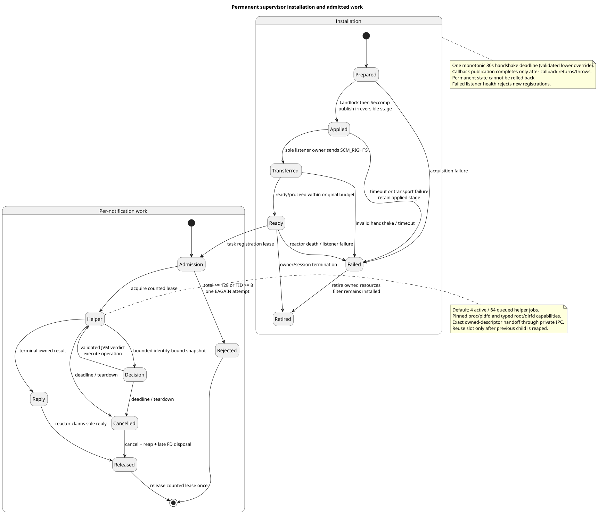
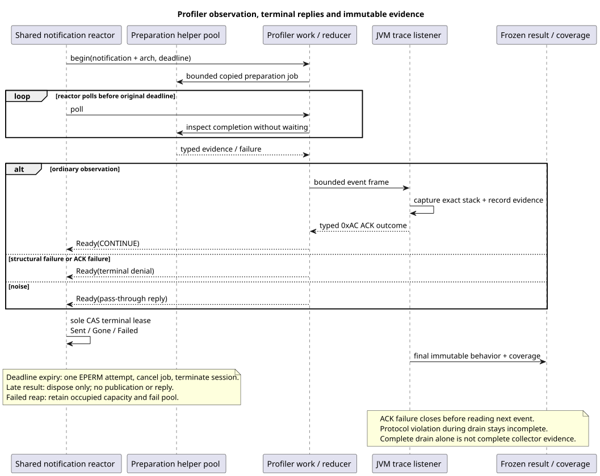
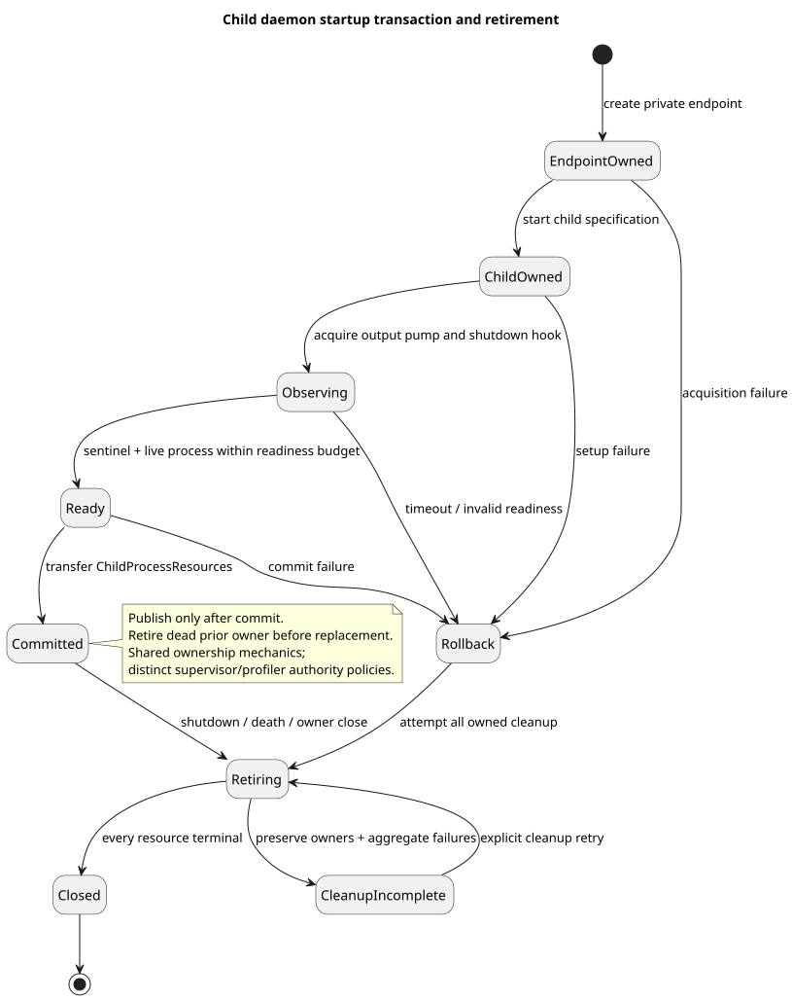

# Notification liveness and ownership contract

This is the cross-module contract for the review-hardening implementation. The
[finding manifest](post-review-hardening-evidence.md#liveness-and-boundary-review-rh)
and [verification record](review-hardening-verification.md) separate implementation
evidence from environment-dependent kernel gates.

## Reactor deadline and reply authority

`SeccompSessionHandler` accepts one notification at a time per listener session.
Receipt starts one monotonic 30-second deadline. `NotificationWork.poll()` performs
bounded local work or a nonblocking I/O attempt and returns `Await` or `Ready`.
The reactor advances work on readiness, idle polls and interrupted polls, choosing
a timeout no later than the pending deadline. It checks expiry both before and
after polling work; completion at the boundary loses to expiry.

Only the reactor claims `NotificationReplyLease` and invokes a terminal reply.
The lease is consumed even if native delivery fails or the effect throws. Every
reply returns the platform-owned sealed `UserNotifReplyResult`: `Sent`,
`NotificationGone` (ENOENT), or `Failed(errno, operation)`. Normal interrupted
SEND/RECV attempts have a ceiling of eight. Deadline expiry claims the lease,
attempts EPERM once and terminates the session, including on EINTR or ENOENT.
There is no fallback reply after a claimed terminal effect. FD injection retains
the atomic ADDFD-with-SEND operation where a syscall returns a new descriptor.

This deadline is the watchdog: it runs in the existing reactor and does not
interrupt arbitrary JVM code. Completion callbacks have disposal authority only.
Closing pending work cancels its counted admission and arranges late-resource
disposal. The reactor never waits for a blocked helper syscall or process reap.
The guarantee assumes the reactor continues to run and its bounded local/native
operations return; it is not a real-time scheduler or protection from kernel hangs.

`NotificationLivenessMetrics.snapshot()` exposes an internal immutable, atomically
published view of process-local cumulative counters: received notifications,
deadline expiries, sent replies, gone notifications, failed replies and late
completions observed by the reactor. Counters saturate at `Long.MAX_VALUE`, retain
no notification identities or paths, and never reset on observation. A terminal
reply effect increments exactly one outcome counter, including thrown reply effects
as failures. Cleanup denial is counted as a reply but is not a deadline expiry.
Late completion means a `Ready` result returned by polling after its deadline;
helper results disposed solely during cancellation are outside this counter.
These counters live in the daemon JVM and do not add a parent-process wire protocol.

### Locks, stalls and the watchdog boundary

The deadline is deliberately a reactor-owned state-machine deadline, not a thread
that attempts to interrupt a handler. A notification handler must never hold a lock
while waiting for a tracee, helper process, listener ACK, or another JVM-owned
coordination primitive. Potentially blocking work is represented by a pollable
effect and is either advanced by readiness or moved to an independently terminable
helper. This prevents a watchdog from becoming a second authority that can race the
reply lease or interrupt arbitrary application code.

Lock contention is observable, but not resolved by force. The reactor records the
pending count, oldest pending age, deadline-near observation, poll/repoll count,
reply latency, and helper saturation. A deadline-near observation is emitted at
most once for a notification and contains no TID, path, descriptor, or payload.
Operators should treat repeated deadline-near observations, increasing oldest age,
or sustained helper saturation as a liveness incident and inspect lock ownership
and helper capacity. Metrics are diagnostics: they do not extend the deadline and
cannot authorize a second reply.

At expiry the reactor performs one compare-and-claim on the notification lease,
attempts the terminal `EPERM` reply once, and closes the session. A late helper or
verdict completion may only dispose its result. It cannot reacquire the lease,
publish an observation, ACK a listener, or send another kernel reply. If the reactor
itself stops polling, no in-process watchdog can guarantee recovery; deployment
health checks should supervise the daemon process and restart it according to the
fail-closed policy.

## Supervisor installation, admission and authority

Installation uses one 30-second monotonic handshake budget, optionally lowered by
validated `mazewall.supervisor.installTimeoutMillis` (1–30000). Permanent state
records filter application before descriptor transfer/readiness, so failed
installation retains every irreversible stage. An applied-stage callback publishes
only after it returns or throws; cleanup joins an in-flight callback exactly once.
That injected callback must be short and nonblocking and is not forcibly interrupted.
Landlock still precedes Seccomp; virtual-thread installation and combined
TSYNC/NEW_LISTENER remain forbidden.

Listener failure marks the installation unusable and rejects new task leases.
Owner retirement closes installation-owned resources; ending a task releases its
registration lease rather than undoing a permanent filter. Cached supervisor reuse
re-establishes the recorded, library-owned Yama ptracer relationship before handing
authority back to its daemon. It never grants `PR_SET_PTRACER_ANY`.

Admission is shared across listener sessions: at most 128 received notifications
total and eight per TID. The ninth/129th admission is rejected before inspection
with one EAGAIN send attempt. Limits count admitted work, not kernel-queued
notifications or a rate per second. The default supervisor helper pool has four
active slots and 64 queued jobs; validated overrides are documented in the
[containment design](../enforcer/containment-design.md#supervisor-session-and-reply-ownership).

Production argument reads, `/proc` inspection, cwd/root capture, descriptor import,
path resolution, blocking socket calls and secure-exec preparation execute in
independently terminable helper JVMs. Their private IPC validates peer credentials,
bounded frames and notification identity. Tracee proc handles and pidfds stay
helper-owned throughout the authorization conversation. Root authority has its own
typed key; an arbitrary caller dirfd cannot select it. The parent validates the
notification before decision and terminal completion. Unknown/unsupported supervised
operations deny; unresolved `.class`, `.jar` and `META-INF` paths have no bypass.
An unreadable exec pathname retains its acquisition errno while the captured
parent identity still reaches stack authorization. An allowed callback cannot
override that failure: the secure-exec handshake reports a denied target, with
no descriptor injection or CONTINUE.

Cancellation removes queued work and retires active helpers. A slot is reusable
only after its previous process is reaped. A process in uninterruptible kernel
sleep may resist even SIGKILL: cleanup reports failure and retains capacity rather
than creating unbounded replacements. Directory handles survive rename, but
concurrent tracee mapping changes are not an atomic memory snapshot. Accept with a
non-null peer-address output fails closed as explicitly unsupported; address-less
accept is verified. The [open accept-capability backlog](../../backlog/issue-20260910-171157-430-restore-accept-peer-address-writes-through-identit.md)
must not be represented as a completed feature.

## Profiler observation and ACK

Profiler and supervisor share native transport, reply classification and lifecycle
mechanics; their authorization and observation reducers remain separate.
Profiler preparation runs in its bounded helper pool, carrying architecture and
typed path evidence into the result. Failed reaping fails the pool without admitting
a replacement beyond capacity. Structural failure after receipt becomes one
terminal denial. A failed noise/pass-through reply cannot publish evidence, wait
for ACK, or attempt a fallback reply.

For an ordinary observation, event transmission and the listener's 0xAC ACK precede
the offered CONTINUE reply so the blocked syscall's stack remains capturable.
The same deadline covers preparation, event write and ACK read. Malformed or absent
ACK is terminal. A listener ACK write error or short write closes the endpoint
before another frame; processing failure remains primary and ACK/cleanup failures
remain suppressed. Invalid TID is a protocol violation without publication/ACK.
Rejected event bodies after a valid TID still discharge their one ACK obligation.
Any rejection during graceful drain remains incomplete evidence.

Final snapshots freeze behavior and collector coverage. Successful executor drain
alone does not prove complete evidence: loss, unresolved paths, failed collection
or missing coverage remain diagnostic and cannot authorize web enforcement by
default. Unused finalized collectors can provide explicitly empty, complete evidence.

## Shared startup ownership, portal and demos

`ChildStartupTransaction` owns endpoint, child, output pump and shutdown hook until
readiness succeeds and `commit()` transfers `ChildProcessResources`. Failed startup
rolls back every acquired resource; failed cleanup retains owners for retry.
Managers retire a dead prior owner before replacing it and retain their distinct
supervisor fail-closed versus profiler observation policies. Cleanup aggregation
preserves fatal failure identity and suppresses each distinct secondary failure once.

Portal broker and worker remain independent machines. Broker output retains bounded,
sanitized lines with discarded-line accounting; exact complete READY controls
publication. A fatal checked-out call retires the process before propagation.
Broker response ID and method must both match. Shutdown rejects calls/replenishment,
drains owned maintenance within a bounded budget and reports incomplete cleanup.
The worker distinguishes clean EOF from I/O failure and a pre-frame idle timeout
from a partial-frame failure. Fatal errors stop before propagation; failed writes
never append an error frame. Dedicated worker containment is process-wide before
guest construction/readiness, including sibling threads that already exist.

Codegen emits host stubs into the host source set and dispatchers/descriptors only
into an explicitly configured worker source set/artifact. Ordinary `build` compiles
that opted-in worker artifact. Worker descriptor loading uses its defining classpath.
`Capability.ReadFd` is supported only as a direct inbound parameter: return types,
collections and DTO nesting are generation errors. Native layouts, wire method IDs,
frame bytes and SCM_RIGHTS ordering remain unchanged.

CLI/agent summaries require authenticated denials and positive controls. Inferred
permission text is inconclusive. CLI `all` does not implicitly profile; `profile`
repeats the exact filesystem read under the compiled policy and rejects incomplete
evidence. Owned fixture cleanup preserves external paths and fatal error identity.
The default web artifact excludes executable deserialization fixtures; the explicit
isolated fixture artifact/profile is documented separately. Compose shares one named
profile volume (profiling read/write, enforcement read-only), with `0.0.0.0` inside
containers and host-loopback-only published ports. Missing/incomplete artifacts fail
enforcement startup unless the existing explicitly unsafe override is chosen.

See the [portal lifecycle](../../../diagrams/portal_lifecycle.svg),
[codegen boundary](../../../diagrams/portal_codegen.svg), and
[web evidence lifecycle](../../../diagrams/vulnerable_web_lifecycle.svg).
# Implementation notes (post-merge hardening)

Handshake acknowledgements and profiler handshakes consume one monotonic deadline. Native
`EINTR` is retried only within a bounded budget; callers return to the reactor between
attempts, so a stalled peer cannot pin a worker indefinitely. A terminal outcome owns the
single reply lease; late work is disposed without a second reply.

The tracee memory reader now accepts native memory and filesystem adapters through its
implementation seam, making failure paths deterministic in tests. CLI-owned process trees
are retired on every outcome, including successful and non-zero exits. Generated nested
portal names use a length-prefixed encoding and compatibility bootstrap resolves names via
the same canonical helper. Test-health fragments escape all JSON control characters.
