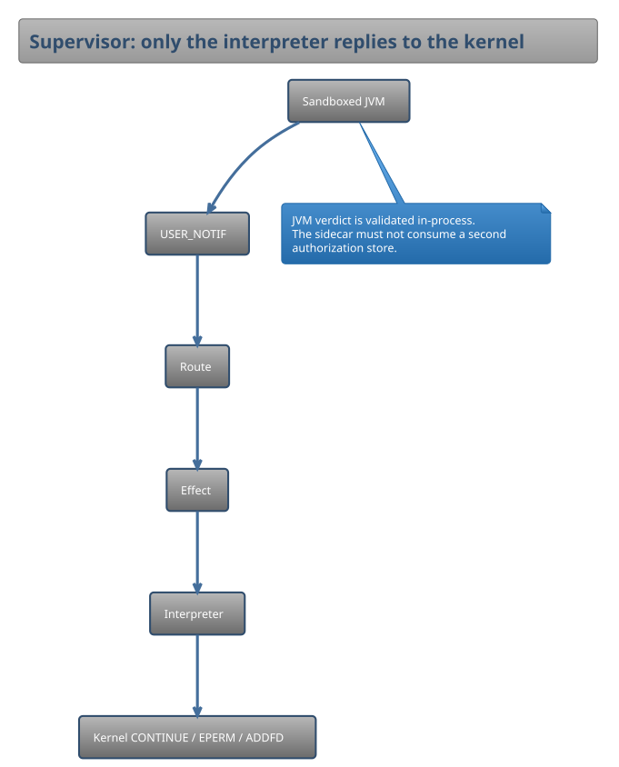

# Enforcer Module Architecture

This document maps the architectural design and class hierarchy of the `:enforcer` module.

## Core Class Diagram

The following diagram illustrates the relationships between the sandbox engine, policy models, native FFM bindings, and the Landlock/Seccomp implementation layers.

Generated source: [enforcer_class_diagram.puml](../../../diagrams/enforcer_class_diagram.puml).

Supervisor USER_NOTIF path (teaching diagram, not a class dump):

Source: [supervisor_notif_flow.puml](../../../diagrams/supervisor_notif_flow.puml).

For cross-module ownership, start at the [canonical architectural knowledge map](../core/architectural-map.md).

Owned worker preparation and the additive actual implementation/resource binding are
described in [prepared resources](prepared-resources-design.md), including descriptor
retirement, explicit recipe rights, ABI requirements and unclosed physical-content gates.
