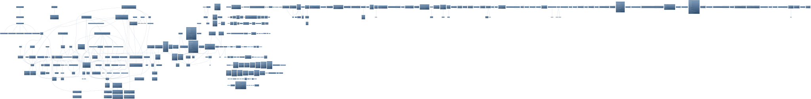

# Enforcer Module Architecture

This document maps the architectural design and class hierarchy of the `:enforcer` module.

## Core Class Diagram

The following diagram illustrates the relationships between the sandbox engine, policy models, native FFM bindings, and the Landlock/Seccomp implementation layers.

Generated source: [enforcer_class_diagram.puml](../../../diagrams/enforcer_class_diagram.puml).
For cross-module ownership, start at the [canonical architectural knowledge map](../core/architectural-map.md).
