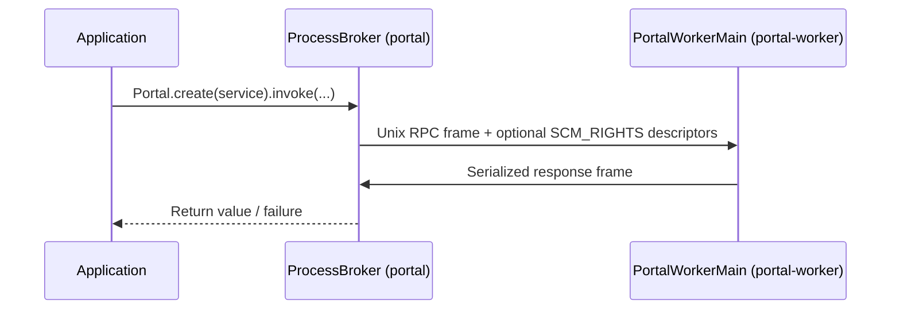

# Portal Architecture Overview

This document records the portal design at a product-level: how mazewall keeps a
risky subsystem in a separate JVM process while preserving typed call semantics.

## Intent

Portal calls are not in-process RPCs. A portal is a broker/worker pair:

- `:portals:runtime` provides the in-process call façade, the Unix socket transport, capability
  tokens, and worker lifecycle orchestration.
- `:portals:worker` hosts the sandboxed execution side.
- `:portals:codegen` generates type-safe adapters so call sites stay ergonomic.

The objective is to prevent risky code from executing with the broker JVM authority.
Everything in the worker process is contained by process-wide policy and may only use
explicitly granted capabilities.

## High-level flow

## Core components

- `ProcessBroker`
  - Manages a pooled set of worker JVMs and admission around call/close operations.
  - Owns startup and close rollback paths, so failed startup cannot leak live children.
- `Portal`
  - Loads a generated stub and prevents broker-side guest implementation fallback.
- `PortalChannel`, `PortalCodec`, `PortalFrame`, `PortalPayload`, `PortalAdmission`
  - Own protocol semantics for framed transport, timeouts, header parsing, and ownership-safe
    descriptor pass-through.
- `PortalWorkerMain`
  - Connects to broker socket, installs worker containment, publishes READY after validator/dispatcher setup,
    then serves request loop.
- `PortalDispatcher*`
  - Routes method IDs to generated dispatchers in worker mode and builtin handlers where present.
- `Capability.ReadFd`
  - Explicit capability tokens; worker receives only broker-admitted descriptor authority.

## Lifecycle model

### Broker lifecycle

The pool is started before calls are accepted and closed only through its explicit
lifecycle state machine.

- `New → Starting → Running`
- `Running → Closing → Closed`
- `Starting/Closing → Failed` on initialization or cleanup failure

If startup cannot publish all workers, the provisional batch is rolled back and reaped.

### Call lifecycle

- Request serialization
- Capability borrow and descriptor transfer
- Reply wait/parse
- Return-to-pool or destroy-on-failure

On transport/protocol failures, the slot is retired from the checked-out state and
recycled as a faulted process replacement path where appropriate. The request result
is propagated immediately; pool replenishment happens independently.

## Security and trust boundaries

- **Fail-closed:** missing generated stubs/invalid dispatch metadata causes
  immediate failure and no host-side execution fallback.
- **No ambient authority leakage:** worker cannot assume parent filesystem/network/process
  authority; work must operate through explicit capabilities.
- **Broker/worker one-way FD direction:** worker receives FDs from broker, not vice versa.
- **Containment prerequisites:** worker installs process-wide policy in `PortalWorkerMain`
  before readiness publication.

## Data model and capability flow

1. App call creates `PortalMethod` request plus a bounded byte payload.
2. Broker opens only requested file handles through the existing capability model
   (`openat2` + `RESOLVE_BENEATH` in broker code path) and wraps them as `Capability.ReadFd`.
3. Broker sends request frame + FDs over `AF_UNIX` sockets using `SCM_RIGHTS`.
4. Worker receives the frame, dispatches to generated handler or builtin handler, serializes response.
5. Broker handles normal result, remote error frame, or protocol failure.

## Timeouts and cancellation

- A per-call absolute deadline is used for each checkout and entire request/response cycle.
- Worker receive loop treats quiet ticks as non-fatal while in idle; once frame activity starts,
  incomplete frames are terminal.
- Interrupted or idle-admission failures close/retire the current slot and propagate
  a portal-level failure.

## Failure policy

1. **Protocol mismatch:** worker/channel state transitions to failed, then terminal cleanup.
2. **I/O completion failures:** worker slot is retired; broker surfaces a deterministic
   portal call failure.
3. **Cleanup failures:** retained and surfaced as evidence/suppressed detail; they do not
   silently convert security/containment failures into success.
4. **Startup rollback:** partial startup is not exposed as live workers.

## Module responsibilities

| Module | Primary responsibility |
| --- | --- |
| `:portals:runtime` | Runtime contract, pooling, framed transport, capability semantics |
| `:portals:worker` | Sandbox process entrypoint, dispatcher validation, method execution |
| `:portals:codegen` | Stub/dispatcher code generation and source artifact production |

## Relationship to other designs

- This is the process isolation counterpart to in-process syscall containment covered by
  enforcer designs.
- Detailed protocol and internal state machines are in
  [process-portal-design.md](enforcer/process-portal-design.md).
- Runtime classpath and startup wiring are represented in [portal lifecycle](../../diagrams/portal_lifecycle.puml).

## Reference sequence snapshots

- [Portal lifecycle diagram](../../diagrams/portal_lifecycle.puml)
- [Codegen pipeline diagram](../../diagrams/portal_codegen.puml)
