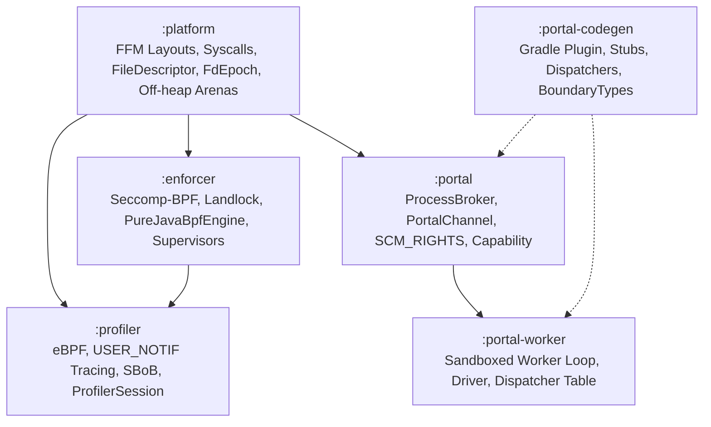

# mazewall Codebase Improvement & Remediation Plan

This plan consolidates verified findings and actionable remediation items across all core modules (`:platform`, `:enforcer`, `:profiler`, `:portal`, `:portal-codegen`, and `:portal-worker`).

## Review reconciliation (2026-09-12)

The second developer review was compared against the existing items before being
added. Existing coverage is retained and expanded; only gaps that were not
already represented are called out below. `tools` remains out of scope.

| Finding | Existing coverage | Reconciled action |
|---|---|---|
| ACK writes can block or spin | Partial deadline work | Add nonblocking `POLLOUT` state and one write attempt per poll. |
| FD-keyed deadline leakage | Missing | Key cleanup by connection identity and add FD-reuse regression. |
| Stale injected memory reader | Partial DI item | Resolve one coherent reader snapshot per operation. |
| Incomplete `OPENAT2` evidence | Partial evidence item | Preserve explicit unknown evidence and reject it during compilation. |
| Evidence lost during merge/copy | Missing | Include typed evidence in merge keys and recompute derived evidence. |
| Duplicate synchronous interpreter | Missing | Remove production `processNotification`; use the reactor harness only. |
| Unbounded agent futures | Missing | Apply absolute deadlines, cancellation, and interruption restoration. |
| Fatal worker reply state | Incomplete lifecycle item | Transition to `Stopped` on every fatal reply path and retain cleanup failures. |
| Dispatcher/name collisions | Partial codegen item | Reject duplicate IDs, reserve encoded names, and support legacy fallback diagnostics. |
| Strace cleanup leaks/masks errors | Partial process item | Re-scan descendants and suppress cleanup failures behind the primary error. |
| Global JNDI switches | Missing | Enable exploit switches only in the isolated vulnerable fixture. |
| Validation readiness can wait forever | Missing | Use the same absolute readiness deadline as the handshake. |
| Test-health escaping/selection | Earlier escaping item | Use one complete JSON escaper and reject stale or unselected declared evidence. |

The implementation order is: bounded USER_NOTIF transport; canonical profiler
evidence; one reactor path; injected native ownership; portal worker and
generated-name correctness; bounded process lifecycle; build/test evidence; and
documentation/backlog closure. Each package must add a focused regression,
run its affected module suite, and be committed independently. Native ABI,
portal frame bytes, method IDs, public compatibility constructors, BPF layout,
Landlock-before-Seccomp ordering, and fail-closed permission handling remain
unchanged. Watchdogs are reactor-owned monotonic deadlines with one reply lease,
not interrupting threads.

### Delivered in this reconciliation pass

- `1dec7efc` — nonblocking USER_NOTIF ACK/control transport, identity-keyed
  handshake deadlines, and bounded validation-channel readiness.
- `60f9ecf6` — per-operation tracee memory-reader dependency resolution.
- `6522b8b1` — explicit incomplete `OPENAT2` evidence, fail-closed compiler,
  evidence-aware merge keys, and copy consistency.
- `97b20d58` — strace cleanup preserves primary failures and rescans late
  descendants.
- `a3be9c6c` — complete JSON escaping for aggregated test-health evidence.
- `2f236d5e`, `a9217065`, `59be49a0` — fatal worker terminal transitions,
  duplicate method-ID rejection, collision validation, and legacy nested
  dispatcher compatibility.
- `d3d6c0ac` — bounded agent tool futures and disabled global JNDI switches in
  normal web startup.

The remaining reactor-only interpreter migration and full demo/integration
matrix are intentionally tracked as follow-up implementation packages; the
existing compatibility entry points remain in place until their callers are
migrated.

---

## Architecture & Dependency Flow Overview

---

## Phase 1: Security Invariants & Kernel Correctness (Fail-Closed)

### 1.1 Fix AARCH64 Linux UAPI Syscall Mismappings
- **Files**:
  - [`platform/src/main/kotlin/io/mazewall/core/Arch.kt`](file:///home/leanid/Documents/code/java/jseccomp/platform/src/main/kotlin/io/mazewall/core/Arch.kt#L262)
  - [`platform/src/main/kotlin/io/mazewall/core/Arch.kt`](file:///home/leanid/Documents/code/java/jseccomp/platform/src/main/kotlin/io/mazewall/core/Arch.kt#L324)
- **Tasks**:
  - [ ] Change `recvmmsg` on AARCH64 from `268` to `243` (`asm-generic/unistd.h`).
  - [ ] Change `statx` on AARCH64 from `397` to `291` (`397` is `__NR_rseq` on ARM64).
  - [ ] Add cross-architecture UAPI unit tests asserting uniqueness of syscall numbers per architecture.

### 1.2 Fail-Closed on Landlock Path Resolution Failure
- **File**:
  - [`enforcer/src/main/kotlin/io/mazewall/landlock/Landlock.kt`](file:///home/leanid/Documents/code/java/jseccomp/enforcer/src/main/kotlin/io/mazewall/landlock/Landlock.kt#L404-L426)
- **Tasks**:
  - [ ] In `addRule`, throw an explicit `LandlockConfigurationException` when `openPath` fails (`openRes is OpenResult.Error`), unless an opt-in non-fatal flag is specified.
  - [ ] Add a unit test verifying that unresolvable mandatory paths trigger fail-closed behavior rather than silent exclusion.

### 1.3 Remove / Gate Test Passwd Probe in Production Dispatcher
- **File**:
  - [`portal-worker/src/main/kotlin/io/mazewall/portal/worker/PortalBuiltinDispatch.kt`](file:///home/leanid/Documents/code/java/jseccomp/portal-worker/src/main/kotlin/io/mazewall/portal/worker/PortalBuiltinDispatch.kt#L44-L47)
- **Tasks**:
  - [ ] Decouple `PortalMethod.TryOpenHostPasswd` from production default dispatch tables; register only in integration test environments.

---

## Phase 2: Memory, Off-Heap & Resource Leak Elimination

### 2.1 Bound Off-Heap `BpfNativeCache`
- **File**:
  - [`enforcer/src/main/kotlin/io/mazewall/BpfNativeCache.kt`](file:///home/leanid/Documents/code/java/jseccomp/enforcer/src/main/kotlin/io/mazewall/BpfNativeCache.kt#L22-L50)
- **Tasks**:
  - [ ] Replace unbounded `ConcurrentHashMap<NativeCacheKey, ManagedSegment>` with a bounded LRU cache (e.g. `MAX_ENTRIES = 256`, matching `PolicyCompilationCache`).
  - [ ] Ensure evicted `ManagedSegment`s close their native allocations.

### 2.2 Fix `FdEpoch.table` Leak on Unowned Descriptors
- **File**:
  - [`platform/src/main/kotlin/io/mazewall/core/FileDescriptor.kt`](file:///home/leanid/Documents/code/java/jseccomp/platform/src/main/kotlin/io/mazewall/core/FileDescriptor.kt#L77-L109)
- **Tasks**:
  - [ ] Skip `FdEpoch.claimOpen(value)` in `open(...)` when ownership is `FdOwnership.Unowned`.
  - [ ] Verify `table` entry count remains zero when creating and discarding unowned descriptors.

### 2.3 Loom / Virtual Thread Off-Heap Leak in `ErrnoSegment`
- **File**:
  - [`platform/src/main/kotlin/io/mazewall/ffi/memory/MemoryWrappers.kt`](file:///home/leanid/Documents/code/java/jseccomp/platform/src/main/kotlin/io/mazewall/ffi/memory/MemoryWrappers.kt#L195)
- **Tasks**:
  - [ ] Replace `Arena.global().allocate(Layouts.ERRNO)` with a carrier-confined segment pool or bounded thread-local carrier cache to prevent unbounded off-heap growth with Loom virtual threads.

### 2.4 Fix Premature Interruption & Zombie Processes in `ProcessBroker`
- **File**:
  - [`portal/src/main/kotlin/io/mazewall/portal/ProcessBroker.kt`](file:///home/leanid/Documents/code/java/jseccomp/portal/src/main/kotlin/io/mazewall/portal/ProcessBroker.kt#L251-L259)
- **Tasks**:
  - [ ] Clear thread interruption status before calling `destroySlot(slot)`.
  - [ ] Restore thread interruption flag inside a `finally` block *after* `slot.process.waitFor` and `slot.pump.thread.join` complete.

### 2.5 Ensure Profiler Session Lifecycle on Executor Shutdown
- **File**:
  - [`profiler/src/main/kotlin/io/mazewall/profiler/Profiler.kt`](file:///home/leanid/Documents/code/java/jseccomp/profiler/src/main/kotlin/io/mazewall/profiler/Profiler.kt#L85-L128)
- **Tasks**:
  - [ ] Implement `AutoCloseable` on `ProfilerExecutorWrapper`.
  - [ ] Override `shutdown()` and `shutdownNow()` to close `session.close()`.

### 2.6 Robust Cleanup Loop in `ProfilerService.shutdown()`
- **File**:
  - [`profiler/src/main/kotlin/io/mazewall/profiler/ProfilerService.kt`](file:///home/leanid/Documents/code/java/jseccomp/profiler/src/main/kotlin/io/mazewall/profiler/ProfilerService.kt#L81-L96)
- **Tasks**:
  - [ ] Wrap individual `closeWithResult()` calls in `try-catch` so a failure closing one session does not skip closing remaining sessions.

---

## Phase 3: Correctness, State Machines & Compile-Time Safety

### 3.1 Preserve Descriptor Receipts in `LinuxNative.SyscallResult.Success`
- **File**:
  - [`platform/src/main/kotlin/io/mazewall/LinuxNative.kt`](file:///home/leanid/Documents/code/java/jseccomp/platform/src/main/kotlin/io/mazewall/LinuxNative.kt#L90-L103)
- **Tasks**:
  - [ ] Move `descriptorReceipts` and `nextDescriptorReceipt` into the primary constructor of `SyscallResult.Success`.
  - [ ] Update `map` to preserve `descriptorReceipts`.

### 3.2 Fix Phantom-Type Invariant in `PureJavaBpfEngine`
- **File**:
  - [`enforcer/src/main/kotlin/io/mazewall/seccomp/PureJavaBpfEngine.kt`](file:///home/leanid/Documents/code/java/jseccomp/enforcer/src/main/kotlin/io/mazewall/seccomp/PureJavaBpfEngine.kt#L32-L68)
- **Tasks**:
  - [ ] Replace mutable singleton object phantom-type casting with an explicit state wrapper class (`LoadedEngine` vs `UninitializedEngine`).

### 3.3 Support / Reject Nullable Components in DTOs
- **Files**:
  - [`portal-codegen/src/main/kotlin/io/mazewall/portal/codegen/BoundaryTypes.kt`](file:///home/leanid/Documents/code/java/jseccomp/portal-codegen/src/main/kotlin/io/mazewall/portal/codegen/BoundaryTypes.kt#L128-L171)
  - [`portal-codegen/src/main/kotlin/io/mazewall/portal/codegen/PortalStubGenerator.kt`](file:///home/leanid/Documents/code/java/jseccomp/portal-codegen/src/main/kotlin/io/mazewall/portal/codegen/PortalStubGenerator.kt#L281-L289)
- **Tasks**:
  - [ ] Track nullability in `describeStructured` for record components / getters.
  - [ ] Implement wire nullability encoding or reject nullable nested DTO fields at compile time with a descriptive error.

### 3.4 Cycle-Safe Exception Unwrapping in Worker Driver
- **File**:
  - [`portal-worker/src/main/kotlin/io/mazewall/portal/worker/PortalWorkerDriver.kt`](file:///home/leanid/Documents/code/java/jseccomp/portal-worker/src/main/kotlin/io/mazewall/portal/worker/PortalWorkerDriver.kt#L129-L134)
- **Tasks**:
  - [ ] Add recursion depth limit / visited identity set to `unwrapInvocation` to eliminate infinite loops on cyclic exception causes.

### 3.5 Method ID Cross-Interface Collision Detection
- **Files**:
  - [`portal-codegen/src/main/kotlin/io/mazewall/portal/codegen/PortalStubGenerator.kt`](file:///home/leanid/Documents/code/java/jseccomp/portal-codegen/src/main/kotlin/io/mazewall/portal/codegen/PortalStubGenerator.kt#L50-L56)
  - [`portal-codegen/src/main/kotlin/io/mazewall/portal/codegen/PortalCodegenPlugin.kt`](file:///home/leanid/Documents/code/java/jseccomp/portal-codegen/src/main/kotlin/io/mazewall/portal/codegen/PortalCodegenPlugin.kt#L64)
- **Tasks**:
  - [ ] Maintain a unified `seenIds` map across all compiled interfaces in `GeneratePortalStubsTask`.
  - [ ] Fail the Gradle build with a clear collision diagnostic when two service methods generate identical IDs.

### 3.6 Numeric Overflow Guard in `ProfilerSession.droppedEvents`
- **File**:
  - [`profiler/src/main/kotlin/io/mazewall/profiler/ProfilerSession.kt`](file:///home/leanid/Documents/code/java/jseccomp/profiler/src/main/kotlin/io/mazewall/profiler/ProfilerSession.kt#L166)
- **Tasks**:
  - [ ] Widen `droppedEvents` accumulation and reporting from `Int` to `Long`.

### 3.7 Deadline Long Arithmetic Overflow Guard
- **File**:
  - [`platform/src/main/kotlin/io/mazewall/core/valueClasses.kt`](file:///home/leanid/Documents/code/java/jseccomp/platform/src/main/kotlin/io/mazewall/core/valueClasses.kt#L159-L166)
- **Tasks**:
  - [ ] Guard `nowNanoTime + ms * 1_000_000L` against positive signed overflow using `Math.multiplyExact` or clamping to `Long.MAX_VALUE`.

---

## Phase 4: Performance, Hot Paths & Concurrency

### 4.1 $O(1)$ Syscall Lookups on Hot Paths
- **File**:
  - [`profiler/src/main/kotlin/io/mazewall/profiler/collector/LiveEbpfCollector.kt`](file:///home/leanid/Documents/code/java/jseccomp/profiler/src/main/kotlin/io/mazewall/profiler/collector/LiveEbpfCollector.kt#L65-L72)
- **Tasks**:
  - [ ] Replace `Syscall.entries.firstOrNull` with precomputed array or `Map<Int, Syscall>` lookup table.

### 4.2 Bulk Memory Copies in Worker Checksum
- **File**:
  - [`portal-worker/src/main/kotlin/io/mazewall/portal/worker/PortalBuiltinDispatch.kt`](file:///home/leanid/Documents/code/java/jseccomp/portal-worker/src/main/kotlin/io/mazewall/portal/worker/PortalBuiltinDispatch.kt#L60-L64)
- **Tasks**:
  - [ ] Replace byte-by-byte off-heap loop with bulk segment copy (`MemorySegment.copy`).

### 4.3 Replace Reflection Dispatch with Direct Handler or MethodHandle
- **File**:
  - [`portal-worker/src/main/kotlin/io/mazewall/portal/worker/PortalDispatcherRegistry.kt`](file:///home/leanid/Documents/code/java/jseccomp/portal-worker/src/main/kotlin/io/mazewall/portal/worker/PortalDispatcherRegistry.kt#L142-L147)
- **Tasks**:
  - [ ] Have generated dispatchers implement a typed interface (e.g. `PortalDispatcherHandler`) to eliminate `Method.invoke` boxing and reflection in worker hot paths.

---

## Phase 5: Cross-Module Duplication & Cleanups

### 5.1 Centralize Shared Constants in `:platform` & `:portal`
- [ ] Add `POLLOUT: Short = 4` to [`NativeConstants.kt`](file:///home/leanid/Documents/code/java/jseccomp/platform/src/main/kotlin/io/mazewall/ffi/NativeConstants.kt).
- [ ] Remove duplicate `F_GETFL`, `F_SETFL`, `O_NONBLOCK`, `POLLOUT` declarations in `PortalIo.kt` and `SeccompInstallTransport.kt`.
- [ ] Move `"MAZEWALL_PORTAL_WORKER_READY"` and `"META-INF/mazewall/portal/"` to shared constants in `:portal`.

### 5.2 Consolidate SBoB JSON Parsing
- [ ] Unify `BillOfBehavior.fromJson` in `:profiler` and `BobDeserializer.kt` in `:enforcer` into a shared parser.

### 5.3 Junior Safety: Restrict `FileDescriptor.unsafe`
- [ ] Elevate `@Deprecated(level = DeprecationLevel.WARNING)` on `FileDescriptor.unsafe` to `DeprecationLevel.ERROR`.
